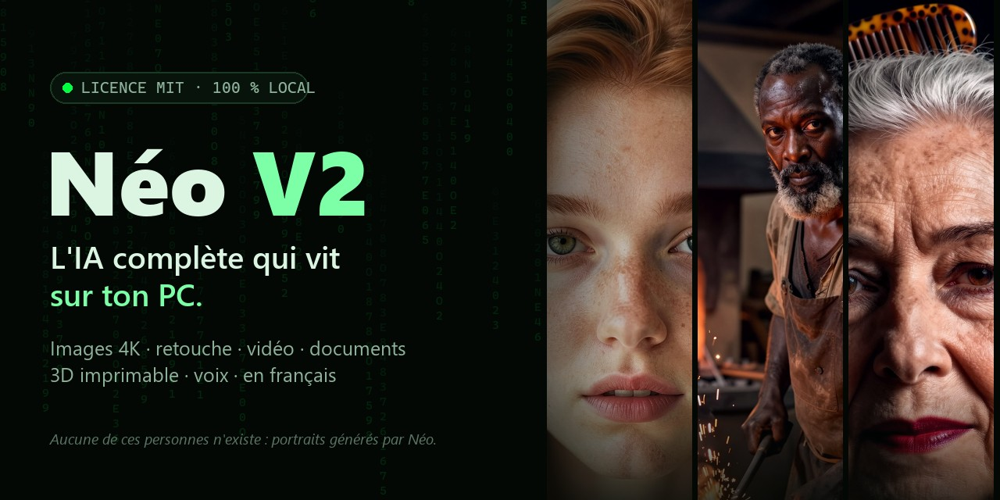
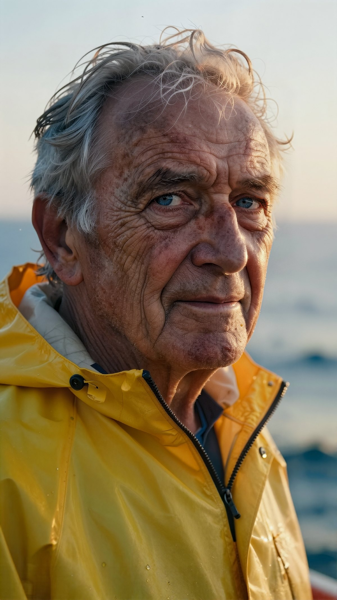
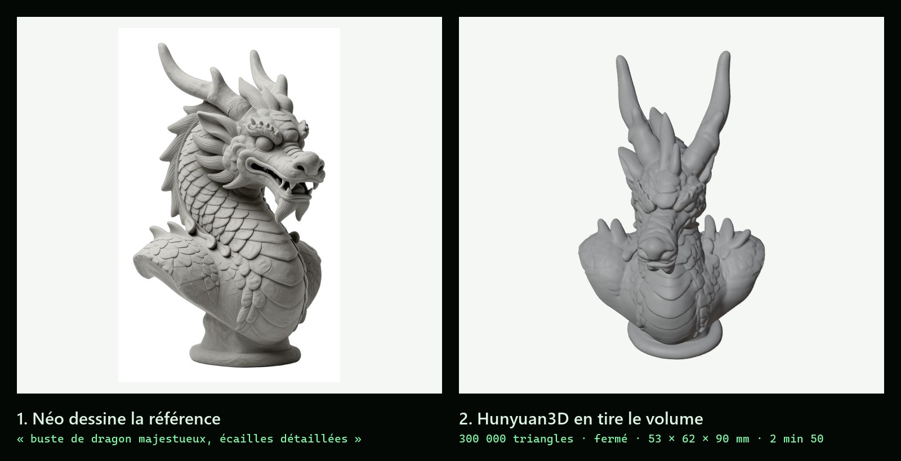
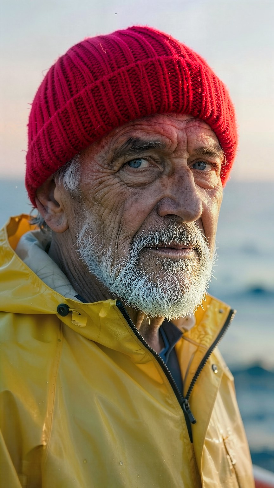

<p align="center">
  
</p>

<h1 align="center">Néo V2</h1>

<p align="center">
  <a href="README.md">Français</a> · <b>English</b>
</p>

<p align="center">
  <b>A complete AI assistant that runs on your PC. Nothing leaves it.</b><br>
  Chat · 4K images · photo editing · video · Office documents · printable 3D · voice<br>
  100% local, no account, no subscription.
</p>

<p align="center">
  
  
  
  
</p>

<p align="center">
  <a href="https://tony2marseille-droid.github.io/Neo-v2/"><b>🌐 Showcase</b></a>
  &nbsp;·&nbsp; <a href="https://github.com/tony2marseille-droid/Neo-v2/releases/latest"><b>⬇️ Download for Windows</b></a>
  &nbsp;·&nbsp; <a href="#-quick-start"><b>🚀 Install</b></a>
  &nbsp;·&nbsp; <a href="docs/DEPENDANCES.md"><b>📜 Model licences</b></a>
</p>

> **Language note.** Néo is a French project. The interface is available in English, but Néo answers in French by default and the detailed documentation in `docs/` is in French.

---

## None of these people exist

Each portrait was requested from Néo in **one sentence**, then painted at 2160 × 3840, retouched (skin, eyes) and checked by its vision model, in **about 75 seconds on a single consumer GPU**. No image ever left the machine.

<table>
  <tr>
    <td width="33%"></td>
    <td width="33%"></td>
    <td width="33%"></td>
  </tr>
  <tr>
    <td></td>
    <td></td>
    <td></td>
  </tr>
</table>

## Why Néo

|  |  |
|---|---|
| 🔒 **Your data stays with you** | Conversations, documents, photos and memory stay on your disk. Nothing is sent to a company. |
| 💸 **Free, and it will stay free** | MIT-licensed code, open models, no subscription, no message limit. |
| 🧰 **It acts, it doesn't just talk** | 62 tools it picks by itself: it builds the Excel file, prepares the 3D print, searches the web and cites its sources. |
| 🧩 **All in one** | Chat, photo studio, video, office documents, 3D, web search and voice in a single application. |
| 🔌 **Plugs into your tools** | OpenAI-compatible API (`/v1`) and an MCP server: use Néo as a backend for Open WebUI, Continue.dev, Cursor or Claude Desktop. |
| 📈 **It improves with you** | Your ratings and its own self-evaluation feed a weekly coach; you can even fine-tune your own model. |

## From V1 to V2: same prompt, same machine

Both portraits below were generated **on the same day, from the same prompt, on the same GPU**: on the left the V1 image engine (FLUX.1-schnell), on the right the V2 studio.

<table>
  <tr>
    <td width="50%"></td>
    <td width="50%"></td>
  </tr>
  <tr><td align="center"><b>V1</b> · FLUX.1-schnell: light brown hair instead of copper, "HDR" look (cropped: this engine only renders landscape)</td><td align="center"><b>V2</b> · Néo studio: copper hair, natural skin, film grain · 71 s, checked 9/10</td></tr>
</table>

| | V1 (Oct 25, 2026) | **V2 (Nov 11, 2026)** |
|---|---|---|
| Specialised agents | 7 | **9** |
| Tools | 41 | **62** |
| Automated tests | 4 | **340** |
| Photo edit by instruction | FLUX Kontext: 140–218 s, whole scene re-generated | **FLUX.2-klein: 17 s**, only what you asked changes |
| Images | FLUX.1-schnell, then upscaling | **Néo studio**: brief, Z-Image-Turbo 4K, face and eye passes, vision check |
| Video | none | **Storyboard → Wan 2.2 → edit** |
| PowerPoint | none | **yes**, with checked Excel formulas |
| 3D | TripoSR from a photo | **parametric templates + Hunyuan3D from a sentence** |
| Voice | Whisper + Windows voice | **Parakeet + Piper neural voice** |
| Interface | one theme | **5 themes** |

*Images and measurements from November 11, 2026 on the reference machine (RTX 5080, 16 GB). The V1 edit time was measured on November 9 on the same machine.*

## From a sentence to a printable object

<p align="center"></p>

Describe a sculpture or a part: Néo draws a reference, turns it into a **watertight, printable mesh**, checks the dimensions and prepares the file for your slicer. For common objects (phone stand, box, hook…), a parametric template gives an exact part in seconds. **[Rotate the dragon in 3D on the showcase page](https://tony2marseille-droid.github.io/Neo-v2/#trois-d).**

## Edit by instruction

> "Give him a red wool beanie and a neatly trimmed white beard; keep his face, his raincoat and the light."

<table>
  <tr>
    <td width="50%"></td>
    <td width="50%"></td>
  </tr>
  <tr><td align="center">Original</td><td align="center"><b>Edited in 17 s</b>: everything else untouched</td></tr>
</table>

## 4K gallery

Five prompts, five 3840 × 2160 images, **43 to 69 seconds** each, rated 8 or 9/10 by Néo's vision model.

<p align="center"></p>

<table>
  <tr>
    <td width="50%"></td>
    <td width="50%"></td>
  </tr>
  <tr>
    <td></td>
    <td></td>
  </tr>
</table>

---

## 🚀 Quick start

**Windows 10 or 11, 64-bit, no admin rights needed.**

1. Download `Neo-…-windows-x64.zip` from the [latest release](https://github.com/tony2marseille-droid/Neo-v2/releases/latest) and extract it, e.g. to `C:\Neo` (avoid `Program Files`).
2. Right-click `installer.ps1` → **Run with PowerShell** (or `powershell -ExecutionPolicy Bypass -File installer.ps1`).
   The installer detects your GPU, installs Python 3.12+ and Ollama if needed (with your consent), then the dependencies and the models that fit your machine.
3. Start Néo with the **"Neo"** shortcut: the interface opens at **http://127.0.0.1:8320**.

Everything machine-specific (folders, ports, tools) lives in one file, **`neo.toml`**, created and commented by the installer (template: [`code/config/neo.exemple.toml`](code/config/neo.exemple.toml)). Useful options: `-Reseau` (allow access from your LAN), `-DossierModeles D:\Models`, `-DemarrageAuto` (start at login), `-Desinstaller` (uninstall, keeps your data).

| Hardware | What works |
|---|---|
| No NVIDIA GPU (or less than 8 GB) | chat with small models, documents, tools, voice, parametric 3D |
| NVIDIA 8 GB | + larger models, 4K image studio |
| NVIDIA 12 GB | + video, 3D from text |
| NVIDIA 16 GB and 32 GB RAM | + fine-tuning |

The image, video and 3D-from-text engines are large downloads and are still a manual step: see [`docs/DEPLOIEMENT.md`](docs/DEPLOIEMENT.md).

The interface greys out the modules your machine can't run and tells you why. Installation has been validated on the reference PC (RTX 5080, 16 GB) and on a laptop with an RTX 3060 (6 GB); every release is also installed on a clean Windows VM before it is published.

## ⚡ Features

| Area | What it does |
|---|---|
| **Chat** | Néo, a character that thinks before answering (Gemma 4 12B, vision included); 9 agents (general, dev, documents/RAG, image, web research, office, system, 3D, code repository), 62 tools, a single router |
| **4K images** | Three-step studio: **understand** (the chat model writes a brief) → **paint** (Z-Image-Turbo, 3840×2160, face and eye passes) → **verify** (vision check). Named real subjects: a reference photo is found and validated first |
| **Editing and filters** | Edit by instruction ("change the sky", "remove…") with FLUX.2-klein in 17 s; 22 filters and effects with instant preview |
| **Video** | Storyboard → one image per shot → **Wan 2.2** (real motion) → ffmpeg edit |
| **Documents** | Word / PDF / Excel / **PowerPoint**: layout, Excel formulas rebuilt and checked |
| **Knowledge cards** | Néo researches, writes and keeps cards (summary, key points, sources) and reuses them |
| **3D / printing** | Parametric templates, free OpenSCAD with a correction loop, **Hunyuan3D** for organic shapes, repairs/booleans, Blender renders, G-code slicing, visual check on 4 views |
| **System** | weather, exchange rates, PC/GPU stats, volume, app launching, screen analysis |
| **Voice** | wake word (openWakeWord), Parakeet / Whisper dictation, Piper neural voice, portable LAN client |
| **Self-improvement** | user ratings + internal judge + a weekly coach that turns weaknesses into rules |
| **Fine-tuning** | corpus → LoRA (unsloth) → merge → GGUF → frozen benchmark → conditional promotion |

## 🔌 API

- **OpenAI-compatible** (`/v1/models`, `/v1/chat/completions`, `/v1/completions`, streaming supported): use Néo as a backend for Open WebUI, LibreChat, AnythingLLM, Continue.dev or Cursor.
- **MCP server** (`POST /mcp`, JSON-RPC 2.0): MCP clients such as Claude Desktop or Cursor discover and call Néo's tools with the same permissions and sandbox.
- **Full pipeline** (agents, tools, RAG, memory) on `POST /api/chat`.

As soon as an API token is set, every non-loopback request needs `Authorization: Bearer <token>`.

```bash
curl http://localhost:8320/v1/chat/completions \
  -H "Content-Type: application/json" \
  -d '{"model":"gemma3:4b","messages":[{"role":"user","content":"Hello"}]}'
```

## 🏗️ Architecture

```
Browser (UI) / LAN voice client / Telegram
                 │  :8320 (SSE + REST)
RUST SERVER (axum): agent routing · tool loop · safeguards · jobs · telemetry
        │ subprocess bridge                │ HTTP
PYTHON (62 tools)                  OLLAMA (Gemma 4, embeddings, your fine-tune)
        │
stable-diffusion.cpp (Z-Image, FLUX.2-klein, Wan 2.2) · Hunyuan3D · OpenSCAD · Blender · Piper · Parakeet
```

A global GPU lock (one generation at a time), a two-layer sandbox (Rust + Python), asynchronous jobs for long tasks, and a supervisor (`localai-watch`) that restarts any failed service.

## 📊 Numbers

Rust server of V2, measured on November 11, 2026 on the `/api/health` route:

| Measure | V2 |
|---|---|
| Server memory | **9.3 MB** |
| Median response time | **0.11 ms** |
| Throughput (8 connections) | **9,733 req/s** |
| Executable | **12.4 MB** |

## 🚧 In development

- **A 3D conversational agent**: an animated character that listens, speaks and reacts during the conversation, right in the interface.
- **Fine-grained coding in every language**: more precise programming functions to write, review, fix and test code, from a quick script to a full project.
- **Linux**: a Docker image exists for the server; a full Linux build is the next step.

## 🛠️ Building from source

```bash
# Rust server, supervisor and launcher
cd code/localai-rs && cargo build --release
# Interface
cd code/frontend && npm ci && npm run build
# Installation package (Windows)
powershell -ExecutionPolicy Bypass -File code/installateur/assembler.ps1 -Version dev
```

Tests: `cargo test --release --workspace` (Rust), `python -m pytest code/tests_unit` (Python, including a guard that rejects any machine-specific path), `npx vitest run` (interface).

## 📜 Licence

Néo's code is released under the **MIT licence** (see [LICENSE](LICENSE)). Dependencies and models keep their own licences; some restrict commercial use or certain countries: see [`docs/DEPENDANCES.md`](docs/DEPENDANCES.md) before downloading them.

⭐ *Star the repository to follow the project, and open an issue with your GPU, RAM and what worked: install reports are the most useful contribution right now.*
