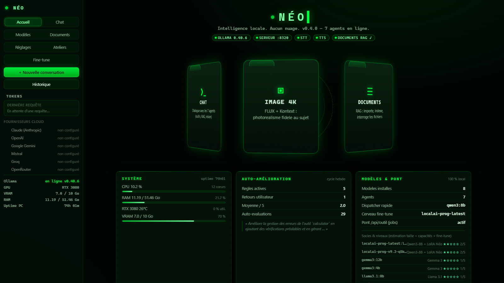
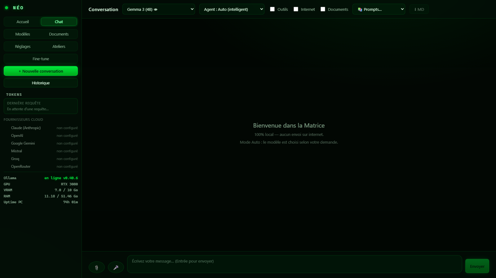
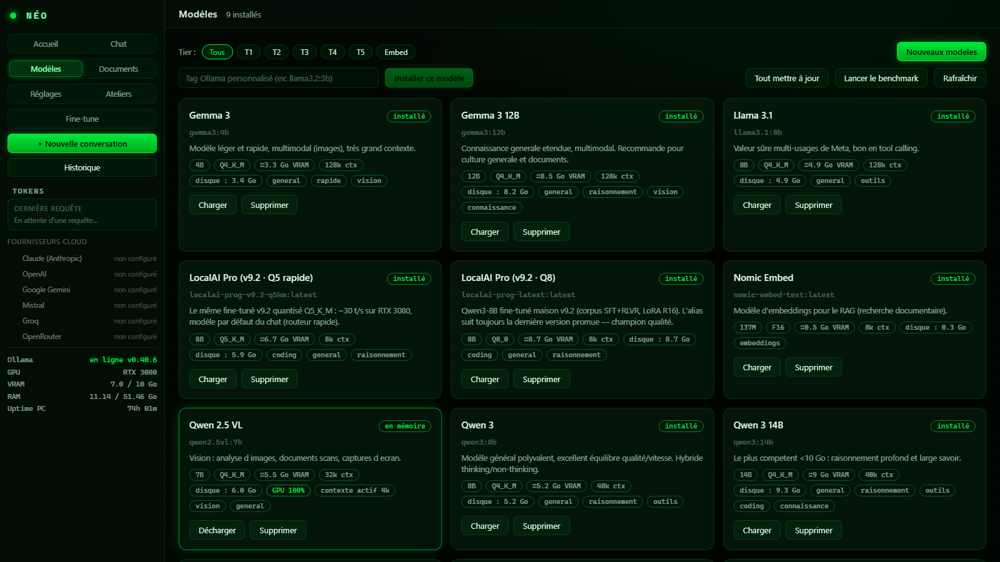
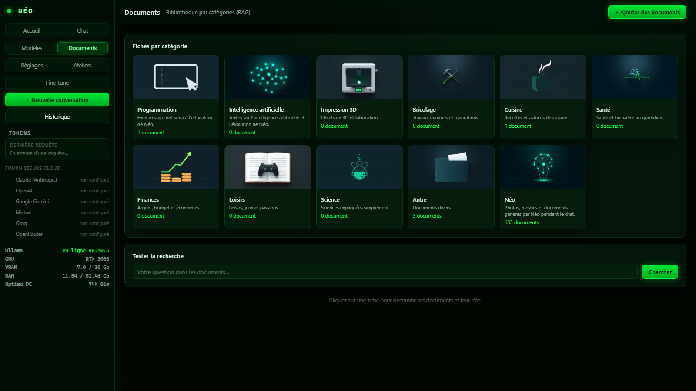
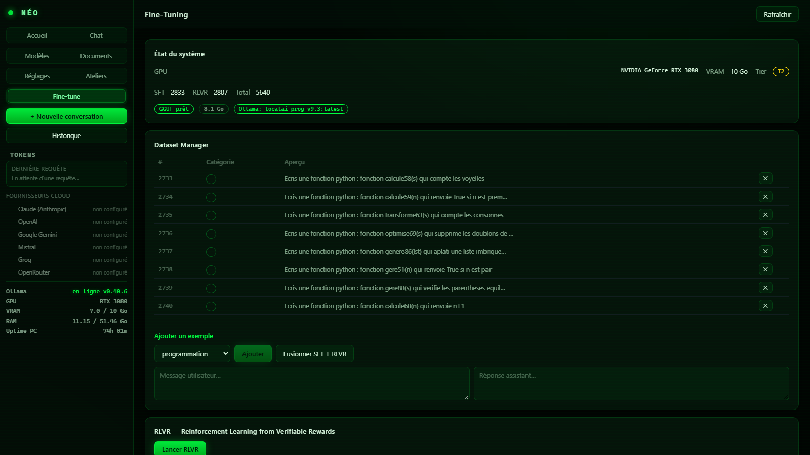

# Néo V2 — Assistant IA 100 % local

> Chat, agents à outils, génération d'images 4K photoréalistes fidèles au sujet,
> 3D/STL imprimable, documents bureautiques, RAG, voix française (mot d'éveil),
> auto-amélioration continue — **tout tourne sur votre PC ; le cloud et les
> clés API restent facultatifs.**

Néo est un assistant IA personnel auto-hébergé qui tourne entièrement en
local : un **serveur Rust** ultra-léger (8 Mo de RAM, 3 680 req/s), un backend
Python spécialisé (kernels SD/TTS/STT/3D), **Ollama** pour l'inférence et un
fine-tune maison. L'ensemble est orchestré comme un majordome numérique :
agents spécialisés, pont vocal, auto-amélioration par cycles d'entraînement.

|  |  |  |
|---|---|---|

*Portraits générés en local par Néo V2, en une phrase chacun (≈ 75 s sur une RTX 5080). Aucune de ces personnes n'existe.*

👉 **Présentation complète : [page de Néo V2](site/index.html)** (publiée sur GitHub Pages).

## 📸 Captures d'écran

| Accueil (thème Matrix) | Chat & agents à outils |
|---|---|
|  |  |

| Modèles (filtres T1–T5) | Documents (RAG) | Auto-amélioration |
|---|---|---|
|  |  |  |

### Exemples de générations 4K (100 % sur votre GPU)

| | | |
|---|---|---|
|  |  |  |
| **Mars** | **SR-71 au coucher du soleil** | **Dragon des enfers** |
|  |  |  |
| **Dragon de glaces** | **Boulanger devant son four** | **Portrait en forêt (détail)** |

*Toutes ces images ont été générées en local par Néo, avec contrôle qualité automatique par le modèle de vision. Les quatre premières datent du studio FLUX ; le boulanger et le portrait viennent du studio actuel (Z-Image-Turbo, visage et yeux retouchés).*

## 🚧 Un projet qui avance

Néo est en **développement actif** : les fonctionnalités existantes sont
améliorées en continu (pipeline image 4K avec formats masters TIFF/EXR,
agents à outils, interface) et de **nouvelles fonctions arrivent** —
suivi de la consommation de tokens en temps réel, bascule automatique
entre modèles, envoi Telegram multi-photos, nouveaux connecteurs et
améliorations de l'auto-amélioration. ⭐ *Star le dépôt pour suivre
les évolutions !*

### À savoir avant de l'essayer

Néo est un projet personnel, construit et réglé sur **une** machine
(Windows 11, RTX 16 Go, 48 Go de RAM, un SSD et un disque d'archives). Il
n'a pas encore été installé ailleurs :

- les chemins par défaut (`E:\ia`, `E:\localai-rs`) se changent par les
  variables d'environnement ci-dessous, mais `code/config/services.json`
  (services lancés par le superviseur) et `correspondances.psd1`
  (déploiement) décrivent l'installation de référence et sont à adapter ;
- les modèles ne sont pas dans le dépôt, et chacun a sa licence — certaines
  interdisent l'usage commercial ou sont limitées à certains pays : lire
  [`docs/DEPENDANCES.md`](docs/DEPENDANCES.md) avant de les télécharger ;
- les temps annoncés sont ceux de cette machine
  ([`docs/MEDIAS.md`](docs/MEDIAS.md) détaille chaque mesure).

---

## ⚡ Fonctionnalités

| Domaine | Ce que ça fait |
|---|---|
| **Chat** | Néo, un personnage qui réfléchit avant de répondre (Gemma 4 12B, vision comprise) ; 9 agents (Néo, dev, documents/RAG, image, recherche web, bureau, système, 3D, dépôt de code), 62 outils, un routeur unique, relance d'un agent qui n'agit pas |
| **Images 4K** | Studio en trois temps : **comprendre** (brief écrit par le modèle de conversation) → **peindre** (Z-Image-Turbo, 3840×2160, passes visage et yeux) → **vérifier** (contrôle par la vision). Portrait par le chat : ~66 s. Sujet réel nommé : photo de référence cherchée puis validée |
| **Retouche et filtres** | Retouche par consigne (« change le ciel », « supprime… ») avec FLUX.2-klein en 8 à 16 s ; 22 filtres et effets avec aperçu immédiat, copie en pleine résolution |
| **Vidéo** | Storyboard → image de chaque plan → **Wan 2.2** (vrai mouvement) → montage ffmpeg ; un plan de 3 s en ~2 min |
| **Documents** | Markdown → Word / PDF / Excel / **PowerPoint** : mise en page, formules Excel retrouvées et vérifiées (totaux, TVA, TTC), montants à la française |
| **Fiches de connaissances** | Néo cherche, rédige et garde des fiches (résumé, points clés, sources) ; il s'en ressert quand le sujet revient |
| **3D / Impression** | Gabarits paramétriques pour les objets courants (pièce juste en 3 s), script OpenSCAD libre avec boucle de correction, **Hunyuan3D** pour les formes organiques depuis une simple description, réparations/booléens/fusions, rendus Blender, tranchage G-code, contrôle visuel sur 4 vues |
| **Système** | météo (Open-Meteo), change (BCE), adresses (IGN), stats PC/GPU, volume, ouverture d'apps, analyse d'écran par vision |
| **Voix** | mot d'éveil vocal (openWakeWord), dictée Parakeet / Whisper, voix française Piper, client LAN portable |
| **Auto-amélioration** | feedback utilisateur (1-5) + auto-évaluation (juge interne) + coach hebdomadaire qui transforme les faiblesses en règles injectées dans le prompt |
| **Fine-tuning maison** | corpus → LoRA (unsloth) → merge → GGUF → bench holdout figé (100 prompts, double juge, Wilson 95 %) → promotion conditionnelle |
| **Installation guidée** | Assistant de première installation : choix de la langue (FR/EN/ES/DE/IT), détection du matériel, plan de modèles adapté (petits en T1, grands en T3), installation en un clic |

## 🏗️ Architecture (résumé)

```
┌────────────────────────────────────────────────────────────┐
│  Navigateur (UI Matrix) / Client vocal LAN / Telegram      │
└──────────────────────────┬─────────────────────────────────┘
                           │ :8320 (SSE + REST)
┌──────────────────────────▼─────────────────────────────────┐
│  SERVEUR RUST (axum) — 8 Mo RAM, 0,46 ms p50, 3680 req/s   │
│  routage agents · boucle outils · gardes-fous · jobs       │
│  auto-évaluation · feedback/coach · télémétrie             │
└───────────┬───────────────────────────────┬────────────────┘
            │ pont sous-processus            │ HTTP
┌───────────▼───────────────┐   ┌────────────▼───────────────┐
│  PYTHON (62 outils)       │   │  OLLAMA :11434             │
│  sdgen · t_image · t_video│   │  gemma4:12b (conversation, │
│  t_mesh · t_pipeline_3d   │   │   vision, agents)          │
│  t_docs · fiches · t_web  │   │  qwen3-embedding (RAG)     │
│  service :8321 (fichiers, │   │  localai-prog-latest       │
│  filtres photo, fiches)   │   │   (fine-tune, agent dev)   │
└───────────────────────────┘   └────────────────────────────┘
            │
   stable-diffusion.cpp (Z-Image, FLUX.2-klein, Wan 2.2) · Hunyuan3D ·
   OpenSCAD · Blender · Piper · Parakeet / Whisper
```

**Verrou GPU global** (une génération à la fois), **sandbox double couche**
(Rust + Python), **jobs asynchrones** pour les tâches longues, **préchauffage
cache** des modèles SD (65 s au lieu de 10-30 min sur SSD QLC).

## 📊 Chiffres

| Mesure | Python (avant) | **Rust (production)** |
|---|---|---|
| RAM serveur | 34,8 Mo | **8,1 Mo** |
| Latence p50 | 0,90 ms | **0,46 ms** |
| Débit (8 co) | 1 458 req/s | **3 680 req/s** |
| Empreinte | venv 138 paquets | **exe 7 Mo** |

👉 Détails complets : [`docs/COMPARATIFS.md`](docs/COMPARATIFS.md) ·
Architecture : [`docs/TECHNIQUE.md`](docs/TECHNIQUE.md) ·
Outils : [`docs/SKILLS.md`](docs/SKILLS.md) ·
Sécurité : [`docs/SECURITE.md`](docs/SECURITE.md) ·
Installation : [`docs/DEPLOIEMENT.md`](docs/DEPLOIEMENT.md)

## 🚀 Démarrage rapide

1. **Prérequis** : Windows 10/11, Ollama, Rust (build), Python 3.11+. Le chat tourne avec une RTX 8 Go et 32 Go de RAM ; le studio image 4K, la vidéo et la 3D organique sont réglés sur l'installation de référence (RTX 16 Go, 48 Go de RAM).
2. Suivre [`docs/DEPLOIEMENT.md`](docs/DEPLOIEMENT.md) (serveur, venv, modèles, tâches planifiées). Bibliothèques Python : [`code/requirements.txt`](code/requirements.txt).
3. `cargo build --release` puis lancer `localai-server.exe` → **http://localhost:8320**.

## ⚙️ Variables d'environnement

Le serveur lit sa configuration dans l'environnement au démarrage
(`localai-core/src/config.rs`). Aucune n'est obligatoire : les valeurs par
défaut correspondent à l'installation de référence.

| Variable | Défaut | Rôle |
|---|---|---|
| `LOCALAI_ROOT` | `E:\ia` | Racine du projet (données, frontend, workspace) |
| `LOCALAI_DATA` | `<racine>\data` | Dossier de la base SQLite et des fichiers générés |
| `LOCALAI_HOST` | `0.0.0.0` | Interface d'écoute (`127.0.0.1` pour restreindre au poste) |
| `LOCALAI_PORT` | `8320` | Port HTTP |
| `OLLAMA_URL` | `http://127.0.0.1:11434` | Endpoint d'Ollama |
| `LOCALAI_MODEL` | `localai-prog-latest` | Modèle par défaut si la base n'en définit pas |

Réglages persistants (table `app_settings`, modifiables via `/api/settings`) :

| Clé | Défaut | Rôle |
|---|---|---|
| `api_token` | *(vide)* | Jeton Bearer exigé des clients non-loopback ; vide = accès LAN libre |
| `webui_user` / `webui_pass` | *(vide)* | Identifiants de l'UI ; `webui_pass` stocké en `sha256$sel$hash` |
| `default_model` | `localai-prog-latest` | Modèle proposé par défaut dans l'UI |
| `model_rapide` | `gemma3:4b` | Modèle des tâches internes (expansion de requêtes, juges) |
| `rag_boost` | `1` | `0` désactive expansion + rerank (RAG vectoriel simple) |
| `rerank_url` | `http://127.0.0.1:8322` | Service cross-encoder ; absent = repli RRF silencieux |

> **Mémoire** : la table `memories` distingue les faits utilisateur
> (`user`, `fait`, `preference`, `projet`), injectés dans le prompt de
> conversation, des notes techniques (`outil`, `agent`, `debug`, `trace`),
> stockées mais **jamais** injectées. Voir `docs/TECHNIQUE.md`.

## 🔌 API

133 routes déclarées, toutes en JSON. `/mcp` fait exception : c'est du
JSON-RPC 2.0 (voir plus bas).

| Famille | Routes principales |
|---|---|
| Chat | `POST /api/chat` (SSE), `GET/POST /api/conversations`, `POST /api/feedback` |
| Mémoire | `GET/POST /api/memory`, `GET /api/memory/stats`, `DELETE /api/memory/:id` |
| Documents / RAG | `POST /api/documents/upload`, `POST /api/documents/search`, `GET /api/documents/fiches`, `GET /api/documents/:id/content` |
| Modèles | `GET /api/models`, `GET /api/models/installed`, `POST /api/models/install`, `POST /api/models/load` |
| Outils | `POST /api/outil/execute`, `GET /api/outil/job/:id`, `POST /mcp` |
| Système | `GET /api/health` (santé + compteurs), `GET /api/system/info`, `GET /api/system/gpu`, `GET /api/system/hardware/pulls` |
| Images / 3D | `POST /api/sd/generate`, `POST /api/sd/image-to-3d`, `GET /api/sd/status` |
| Voix | `POST /api/voice/transcribe`, `POST /api/tts`, `GET /api/tts/voices` |
| Fine-tuning | `POST /api/finetune/train`, `GET /api/finetune/status`, `POST /api/finetune/rlvr/run` |
| Conseil / veille | `POST /api/conseil/lancer`, `GET /api/conseil/idees`, `POST /api/veille/lancer` |
| Auth | `GET /api/auth/status`, `POST /api/auth/login`, `POST /api/auth/setup` |

Liste exhaustive : `routes/mod.rs` et les modules de `localai-server/src/routes/`.

### Passerelle compatible OpenAI (`/v1`)

Néo expose le protocole OpenAI : il peut servir de backend à Open WebUI,
LibreChat, AnythingLLM, Cherry Studio, Continue.dev ou Cursor.

| Route | Rôle |
|---|---|
| `GET /v1/models` | Liste des modèles Ollama installés |
| `GET /v1/models/:id` | Détail d'un modèle (`404` si absent) |
| `POST /v1/chat/completions` | Chat ; `stream: true` → SSE avec `[DONE]` final |
| `POST /v1/completions` | Complétion texte « legacy » |

```bash
curl http://localhost:8320/v1/models

curl http://localhost:8320/v1/chat/completions \
  -H "Content-Type: application/json" \
  -d '{"model":"gemma3:4b","messages":[{"role":"user","content":"Bonjour"}]}'
```

Ces routes sont volontairement « pures » : ni RAG, ni outils, ni agents — un
client OpenAI gère son propre contexte. Le pipeline complet (agents, outils,
RAG, mémoire) reste sur `POST /api/chat`. Comme `/api/*`, `/v1/*` exige le
jeton Bearer dès que `api_token` est défini ; les appels loopback passent
toujours.

### Serveur MCP (`POST /mcp`)

Néo parle le Model Context Protocol en JSON-RPC 2.0 sur HTTP. Un client MCP
(Claude Desktop, Cursor, Continue.dev…) découvre et appelle les **58 outils**
avec le même pipeline que `/api/outil/execute` : mêmes permissions
(`tool_level`), même sandbox, même exécution Python.

| Méthode | Réponse |
|---|---|
| `initialize` | version négociée, `capabilities.tools`, `serverInfo` |
| `tools/list` | 58 outils (`name`, `description`, `inputSchema`) |
| `tools/call` | exécute l'outil, renvoie `content[].text` + `isError` |
| `ping` | `{}` |
| `resources/list`, `prompts/list` | listes vides (capacités non annoncées) |

```bash
curl http://127.0.0.1:8320/mcp \
  -H "Content-Type: application/json" \
  -d '{"jsonrpc":"2.0","id":1,"method":"tools/call",
       "params":{"name":"calculator","arguments":{"expression":"(12+30)*2"}}}'
# -> {"jsonrpc":"2.0","id":1,"result":{"content":[{"type":"text","text":"84"}],"isError":false}}
```

`/mcp` est protégé par le même jeton Bearer que `/api/*` et compte dans la
limitation de débit. C'est le **serveur** MCP : Néo n'est pas encore client
MCP (il ne consomme pas les outils d'un autre serveur).

### Santé et observabilité

`GET /api/health` renvoie toujours `status: "ok"` tant que le processus
répond — le watchdog ne doit pas redémarrer le serveur pour une dépendance
dégradée. La dégradation est exposée à part :

```json
{
  "status": "ok",
  "degraded": false,
  "limite_debit_par_minute": 300,
  "metrics": {
    "rag_requetes": 12, "rag_vides": 1, "rag_echecs": 0,
    "embed_echecs": 0, "rerank_ok": 9, "rerank_repli": 3,
    "ollama_echecs": 0, "rate_limited": 0
  }
}
```

`degraded` passe à `true` dès qu'un embedding, un RAG ou une génération
Ollama a échoué depuis le démarrage : c'est exactement la panne silencieuse
qui avait rendu le RAG muet sans alerter personne.

### Limitation de débit

Les routes qui coûtent du GPU (`/api/chat`, `/api/outil/execute`,
`/v1/chat/completions`, `/v1/completions`, `/mcp`) sont limitées par IP sur
une fenêtre glissante de 60 s. Réglage : `rate_limit_par_minute` dans
`app_settings` (défaut **300**, `0` désactive). Au-delà :

```
HTTP/1.1 429 Too Many Requests
Retry-After: 60
{"error":"limite de debit atteinte","limite_par_minute":300,"retry_after":60}
```

Le réglage est lu **au démarrage** : un changement demande un redémarrage.
Les lectures (santé, listes, documents) ne sont jamais limitées, pour que
l'interface ne se bloque pas elle-même.

### Citations RAG

Quand le RAG alimente une réponse, l'événement SSE `meta` porte les extraits
réellement injectés :

```json
{"type":"meta","rag_sources":[
  {"document_id":33,"filename":"security.py","position":3,
   "score":0.07,"url":"/api/documents/33/content#p3"}
]}
```

L'interface affiche ces sources sous la réponse ; le lien ouvre la page du
document, positionnée sur l'extrait (`GET /api/documents/:id/content`).

### Authentification

Dès qu'un jeton est défini (`api_token`), **`/api/*`, `/v1/*` et `/mcp`** exigent
`Authorization: Bearer <jeton>` pour toute requête **non-loopback**.
Restent publics : `/api/health`, `/api/auth/status`, `/api/auth/login`.
Le jeton est relu en base à chaque requête — aucun redémarrage nécessaire.

```bash
# Définir (ou changer) le pseudo, le mot de passe et le jeton
curl http://127.0.0.1:8320/api/auth/setup \
  -H "Content-Type: application/json" \
  -d '{"user":"Camille","pass":"mot-de-passe","old_pass":"ancien-si-deja-configure"}'
# -> {"ok":true,"token":"<64 hex>"}

# Récupérer le jeton depuis un client
curl http://<adresse-de-neo>:8320/api/auth/login \
  -H "Content-Type: application/json" \
  -d '{"user":"Camille","pass":"mot-de-passe"}'
```

L'UI servie localement n'a pas besoin de se connecter ; depuis une autre
machine, elle affiche l'écran de login. Détail et limites : `docs/SECURITE.md`.

## 🧪 Tests

```bash
# Tests unitaires (aucun service requis)
cd code/localai-rs
cargo test --release -p localai-server

# Tests d'intégration réels : embeddings + chaîne RAG bout en bout.
# Exigent Ollama avec nomic-embed-text ; ignorés si NEO_LIVE_TESTS != 1.
$env:NEO_LIVE_TESTS = "1"
cargo test --release -p localai-server documents::

# Frontend
cd code/frontend
npm ci
npx tsc -b
npx oxlint
```

Les tests d'intégration couvrent précisément la panne qui avait échoué en
production : `rag_block` doit retrouver un document **même quand le service
de rerank est injoignable** (repli sur le classement RRF).

Couverture actuelle : **19 tests** (dont 2 réels), répartis sur `documents`
(cosine, packing, découpage, échappement HTML, RAG bout en bout), `rag_boost`
(RRF), `rate_limit` (plafond, désactivation, `Retry-After`), `mcp`
(conversion des schémas), `models` et `reasoning`.

La CI GitHub Actions (`.github/workflows/ci.yml`) exécute à chaque push :
`cargo clippy`, `cargo test --workspace`, `tsc -b`, `oxlint` et
`compileall`. Les tests réels sont neutralisés sans `NEO_LIVE_TESTS=1`, donc
la CI reste verte sur un runner sans GPU.

## 🔄 Le dépôt est la source unique

On modifie **uniquement** `code/` dans ce dépôt, on commite, puis on déploie.
La production (`E:\localai-rs`, `E:\ia`) n'est jamais éditée à la main.

```powershell
git commit -m "..."                       # deployer.ps1 refuse un dépôt non commité
.\deployer.ps1                            # simulation : liste les fichiers qui changeront
.\deployer.ps1 -Executer                  # console administrateur
.\verifier_ecart.ps1                      # à tout moment : la production a-t-elle divergé ?
```

- `correspondances.psd1` est la **seule** table « fichier du dépôt → emplacement
  en production » ; déploiement, contrôle d'écart et retour arrière la lisent.
- Chaque déploiement sauvegarde ce qu'il remplace (`E:\ia\_sauvegardes`), grave
  le commit dans le binaire (`/api/version`) et l'inscrit dans `E:\ia\DEPLOIEMENT.json`.
- Correctif urgent fait en production : `verifier_ecart.ps1 -Rapatrier` le
  recopie dans `code/`, puis relire, commiter et redéployer.
- Retour arrière : `annuler_deploiement.ps1 -Sauvegarde <dossier> -Executer`.

## 📁 Structure du dépôt

```
correspondances.psd1   # Table dépôt -> production (source unique des chemins)
deployer.ps1           # Déploiement avec sauvegarde, build séparé, bascule, contrôles
verifier_ecart.ps1     # Détecte toute modification faite en production
annuler_deploiement.ps1
code/
├── localai-rs/     # Serveur Rust (core, server, pipeline, watch, neo-silencieux)
├── backend/        # Kernels Python (outils, SD, RAG, TTS/STT)
├── frontend/       # UI React/Vite (thème Matrix, accueil animé)
├── config/         # Catalogue de modèles (models.json)
├── racine/         # Scripts posés à la racine de E:\ia (boot, garde, conseil, veille, vidéo…)
├── tools/toolshim/ # Proxy d'émulation des appels d'outils
└── scripts/        # Installation et tâches planifiées silencieuses
docs/               # Documentation technique complète
```

## 🇫🇷 Langue

Le projet est pensé **francophone d'abord** : interface, prompts d'agents,
TTS/STT, documents générés — tout est en français par défaut (traduction
automatique FR→EN pour les prompts de génération d'images).

## ⚠️ Note

Ce dépôt documente et partage une architecture **personnelle fonctionnelle**.
Les modèles (GGUF, fine-tunes) ne sont pas inclus (téléchargeables via Ollama
et Hugging Face). Les chemins font référence à `E:\ia` — adaptez à votre
machine via les variables d'environnement `LOCALAI_*`.

---

*Développé avec passion, en local, sans cloud.*
---

*© 2026 — Néo. Code publié sous licence MIT (voir [LICENSE](LICENSE)).
Les dépendances et les modèles gardent leurs propres licences : voir docs/DEPENDANCES.md.*

## 🔎 Mots-clés

`assistant IA local` · `LLM auto-hébergé` · `Ollama` · `Rust` · `Axum` · `React` · `TypeScript` ·
`FLUX.1` · `génération d'images 4K` · `text-to-image` · `text-to-3D` · `imprimante 3D` · `STL` ·
`RAG` · `chatbot hors ligne` · `Telegram bot` · `Whisper STT` · `TTS français` · `fine-tuning LoRA` ·
`GGUF` · `stable diffusion` · `agents à outils` · `auto-hébergé` · `vie privée` · `sans cloud`
